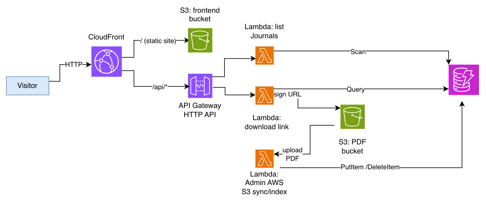

# Serverless Journal Archive

A serverless portal for browsing and downloading an archive of PDF journals (one journal per month, two parts each, filed by year). Drop a PDF into S3 and it appears on the website automatically. Downloads use short-lived pre-signed URLs, so the PDF bucket is never public.

**Managed by: Nina Janev** · CS 79C, AWS Architecture Portfolio Project

| | |
|---|---|
| **Status** | Deployed on AWS in `us-west-2`, tested (including from another country), evidence captured, then torn down on 10/24/26|
| **Stack** | CloudFront, S3, API Gateway (HTTP API), Lambda, DynamoDB, IAM, CloudFormation |
| **Report** | [docs/Journal_Archive_Report.pdf](docs/Journal_Archive_Report.pdf) |
| **Cost estimate** | About $0.09 per month: [AWS Pricing Calculator estimate](https://calculator.aws/#/estimate?id=2b65b03c64828cdf579c33c9a1dc23d7c8069a2f) |

## Architecture




### How a request flows
1. **Browse:** the browser loads the site from CloudFront (S3 origin), then calls `/api/journals`. A Lambda scans DynamoDB and returns year, month and part.
2. **Download:** clicking Part 1 or 2 calls `/api/download?year=1967&month=March&part=1`. The Lambda looks up the S3 key in DynamoDB (the client never supplies a key), signs a 5-minute GET URL, and the browser downloads the PDF directly from the private bucket.
3. **Upload:** copying `1967/1967-March-1.pdf` into the PDF bucket triggers the indexer Lambda, which parses the file name and writes the catalog entry. Deleting a PDF removes its entry.

## Why these services

| Choice | Rejected alternative | Why |
|---|---|---|
| S3 for PDFs and the site | EBS or EFS | Static, unstructured files need cheap, durable, HTTPS-native storage; EBS and EFS are for running servers. |
| DynamoDB for the catalog | RDS | Simple key lookups, no joins; on-demand billing has no idle cost and no schema migrations. |
| Lambda | EC2 or Fargate | Tiny, bursty traffic: pay per invocation instead of running a VM or container 24/7. |
| API Gateway HTTP API | REST API; load balancer | Lower per-request price than REST ($1.00 vs $3.50 per million); a load balancer bills hourly even when idle. |
| CloudFront | S3 static website hosting | HTTPS, edge caching, one domain for site and API (no CORS), and a private website bucket via Origin Access Control. |
| Pre-signed URLs | Public bucket; proxying through Lambda | Keeps the bucket private, expires in 5 minutes, and moves no PDF data through Lambda. |
| S3 event to indexer Lambda | Manual entries; scheduled scan | The catalog updates within seconds of an upload with no polling. |
| One IAM role per Lambda | Shared role; access keys | Each function gets only the actions it needs; no long-lived keys. |
| CloudFormation | Terraform; console clicks | Native to AWS, one template for the whole stack, clean delete. |

## Repository layout
```
template.yaml          CloudFormation template for the whole stack
frontend/index.html    The website
docs/                  Architecture diagram and the written report
evidence/              Screenshots of the running system
```

## Deploy

You need an AWS account and the AWS CLI configured. Use the same region for every command (I used `us-west-2`), and a **lowercase** stack name, because it becomes part of a bucket name. The same steps work in the CloudFormation and S3 consoles.

```bash
# 1. Create the stack (about 5 to 10 minutes; CloudFront is the slow part)
aws cloudformation deploy \
  --template-file template.yaml \
  --stack-name journal-archive \
  --capabilities CAPABILITY_IAM \
  --region us-west-2

# 2. Read the outputs: site URL, bucket names, distribution id
aws cloudformation describe-stacks --stack-name journal-archive \
  --region us-west-2 --query "Stacks[0].Outputs" --output table

# 3. Publish the website 
aws s3 cp frontend/index.html s3://<FrontendBucketName>/index.html \
  --content-type text/html

# 4. Upload journals (local layout: journals/1967/1967-March-1.pdf, ...)
aws s3 sync ./journals s3://<JournalBucketName>/ --exclude "*" --include "*.pdf"
```

Open the `SiteURL` output. The S3 object URLs return Access Denied by design; the site is reached only through the CloudFront domain.

After changing `index.html`, re-upload it and clear the CloudFront cache:
`aws cloudfront create-invalidation --distribution-id <DistributionId> --paths "/*"`

### File naming
PDFs must be stored as `<year>/<year>-<Month>-<1|2>.pdf`, for example `1967/1967-March-1.pdf` and `1992/1992-June-2.pdf`. Anything else is skipped and logged in the indexer's CloudWatch log group. The journal PDFs themselves are not in this repository.

If the catalog is ever lost, it can be rebuilt by re-triggering the indexer: copy the objects onto themselves (`aws s3 cp s3://<bucket>/ s3://<bucket>/ --recursive --metadata-directive REPLACE`).

## Security, reliability, performance, cost
- **Security:** no access keys; one least-privilege IAM role per Lambda; both buckets block public access and use AES-256 encryption; the website bucket is readable only by CloudFront (Origin Access Control); PDFs are reachable only via 5-minute pre-signed URLs; HTTPS only; API throttled to 10 requests per second per route.
- **Reliability:** managed multi-AZ services; the PDF bucket is versioned; DynamoDB has point-in-time recovery; the catalog can be rebuilt from S3. Single region (backup-and-restore DR).
- **Performance:** the site is cached at CloudFront edges; PDFs come straight from S3; Lambda and on-demand DynamoDB scale automatically. Known bottleneck: the list endpoint scans the whole table.
- **Cost:** pay-per-use with no always-on components. Estimate of about $0.09 per month for about 3 GB of PDFs and 1,000 visits (see the report for assumptions).

## Challenges I hit
- **First deployment rolled back.** CloudFront rejected hard-coded IDs for its built-in cache policies ("cache policy does not exist"). Fix: define the cache and origin-request policies as resources in the template.
- **Downloads failed with a region error.** The Lambda's default S3 client signed URLs against the global endpoint, but the bucket is in `us-west-2`. Fix: configure the client with the regional endpoint.
- **Misleading signals.** CloudFormation's Events tab keeps old *IN_PROGRESS* rows after a resource finishes (the stack status is the source of truth), and S3 object URLs show Access Denied because the buckets are private.

## Well-Architected self-review
| Pillar | Does well | Would improve |
|---|---|---|
| Security | Private buckets, OAC, least-privilege roles, short-lived signed URLs | No authentication on the API and no WAF |
| Reliability | Managed multi-AZ services, versioning, point-in-time recovery | Single region; no alarms on Lambda errors; recovery not rehearsed |
| Cost Optimization | Fully pay-per-use | No S3 lifecycle tiering; uncached list endpoint |

## Evidence
Screenshots of the running system are in [`evidence/`](evidence/): the site with my name in the footer, a working download, the CloudFormation stack, DynamoDB items, S3 buckets, Lambda functions and the indexer log.

## Tear down
1. In the S3 console, select each of the two buckets and choose **Empty** (the PDF bucket is versioned, so the console button is the easiest way to remove every version).
2. `aws cloudformation delete-stack --stack-name journal-archive --region us-west-2`
3. Delete the three Lambda log groups whose names start with `/aws/lambda/journal-archive` (CloudFormation does not remove them).
4. Confirm the stack and both buckets are gone.
